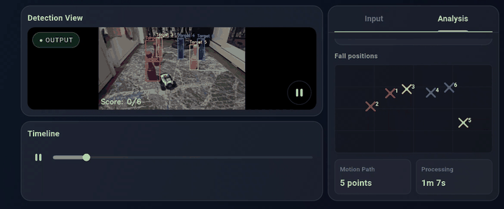
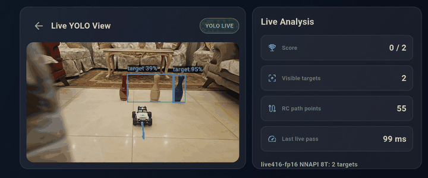
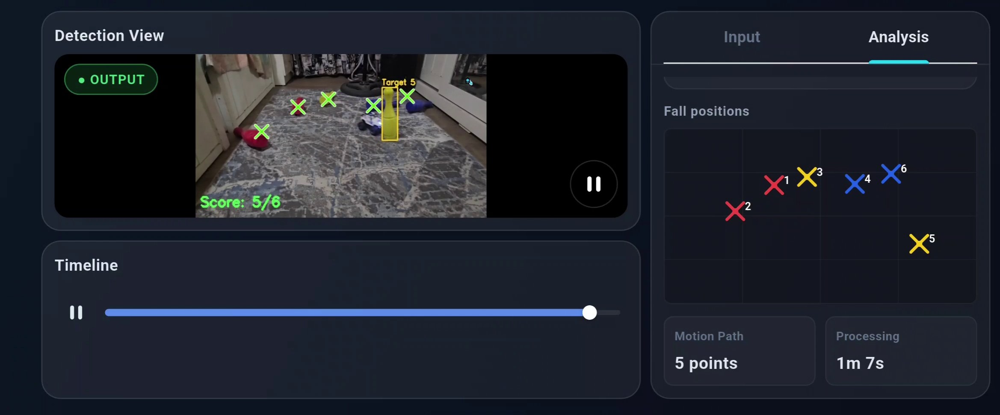

# Trackt

An Android app that watches an RC car knock down bowling pins and tells you exactly what happened: which pins fell, in what order, and the path the car took. Everything runs on the phone, no internet.

Built for DSAI 352 (Computer Vision) at Zewail City. Scored 6/6 on every real test video.

<p align="center">
  
  
</p>
<p align="center"><sub>Offline mode on a recorded video · Live mode on the camera feed</sub></p>

## What it does

**Offline.** Pick or record a video. Trackt goes through it, follows all 6 pins (2 red, 2 blue, 2 yellow), marks each one the moment it falls, numbers the falling order, draws the car's path, and exports an annotated video plus a JSON with the results.

**Live.** Point the camera at the scene. A YOLO model runs on the camera stream at around 100 ms per frame, keeps track of each pin, and draws the car's path while it drives.



## How it works

- Offline mode is a hybrid. Color masks find the pins, and a small YOLO model helps confirm what is standing and what is down.
- The model was trained with Ultralytics and exported to TFLite, with three classes: `target_standing`, `target_fallen`, `rc_car`.
- Live tracking is tracking-by-detection. Boxes are matched across frames by IoU, center distance and size, so a weak detection can update a pin but can't create a fake one.
- A pin only counts as fallen after it's seen down in consecutive frames, so one bad frame can't change the score.
- If the model loses the car, a motion fallback keeps the path going.

## Results

Tested on 4 real recordings of the assignment setup. 6/6 on all of them, with the car's path drawn every time.

## Try it

Grab the APK from [Releases](../../releases) and install it on any Android phone.

Or build it yourself:

```bash
cd app
flutter pub get
flutter build apk --release
```

## Repo

```
app/        Flutter app: UI, CV pipeline, live detector
training/   dataset prep, YOLO training, TFLite export
docs/       gifs and screenshots
```

Flutter · opencv_dart · tflite_flutter · Ultralytics YOLO · camera · media_kit
